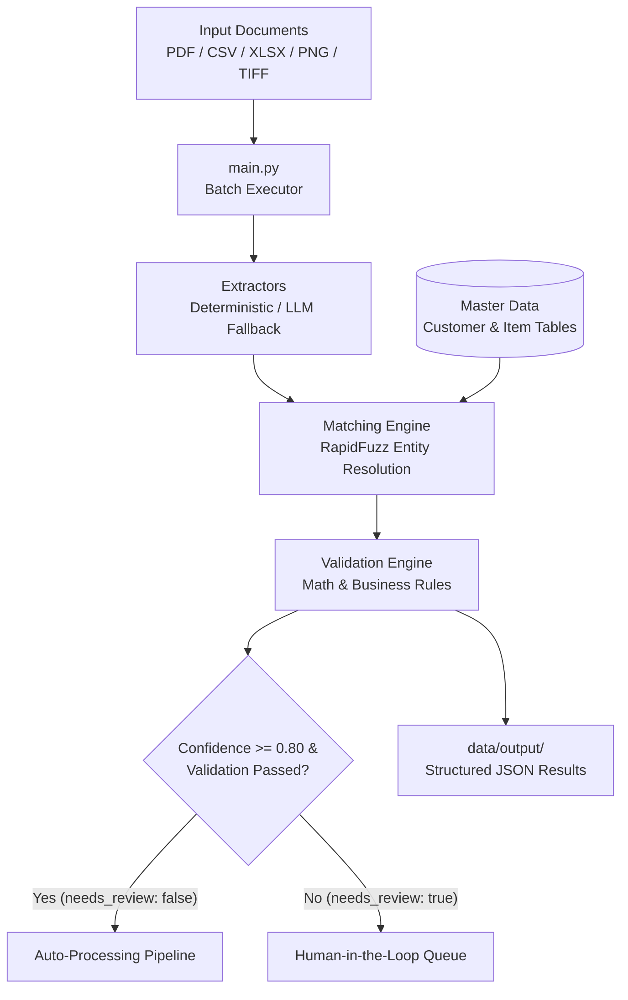

# Hybrid AI Intelligent Document Processing (IDP) Pipeline
An automated, production-ready pipeline designed to ingest, extract, validate, and match structured data from multi-format business documents (purchase orders, invoices, price lists) against enterprise Master Data.

---

## Key Features
- **Multi-Format Ingestion**: Supports `.csv`, `.xlsx`, `.xls`, `.pdf`, and image formats (`.png`, `.jpg`, `.jpeg`, `.tiff`, `.bmp`).
- **Hybrid Extraction Engine**:
  - **Deterministic Parsing**: Native layout processing for structured spreadsheets and tabular data.
  - **LLM Fallback Extraction**: Local text/vision extraction via Ollama (e.g., Qwen 2.5 model) for unstructured invoices, scans, and irregular PDFs, ensuring 100% data privacy.
- **Master Data Entity Resolution**: Automated fuzzy matching (`RapidFuzz`) against Customer (`score_cutoff=50.0`) and Item (`score_cutoff=60.0`) master datasets.
- **Business Logic & Math Validation**: Automated checks for quantity/unit price consistency, tax/shipping totals, missing required fields, and customer identification.
- **Batch Processing & Rate Limiting**: Processes all files in `data/raw/` in batch mode with built-in throttling (`time.sleep(3)`) to maintain stability.
- **Human-in-the-Loop (HITL) Readiness**: Automatic flagging (`needs_review: true`) with detailed reasons when confidence drops below 0.80 or validation fails.

---

### 🏗 System Architecture Workflow



---

## 📁 Project Structure

```text
idp-document-pipeline/
├── main.py # Main entry point for batch processing
├── requirements.txt # Python dependencies
├── .env # Environment variables
├── data/
│ ├── master/ # Master Data reference files (Customer & Item tables)
│ ├── raw/ # Input documents directory (PDF, XLSX, CSV, Images)
│ └── output/ # Generated JSON processing results
├── src/
│ ├── extractors/ # Base, PDF, Image, CSV/XLSX & LLM extractors
│ ├── matching.py # RapidFuzz entity matching against master data
│ ├── validation.py # Business rules & mathematical verification
│ ├── pipeline.py # Document processing pipeline orchestrator
│ └── schemas.py # Pydantic models for data validation
└── tests/ # Unit & integration tests
```

---

## 🚀 Quick Start & Setup
### Prerequisites
- **Python:** 3.10+
- **Environment:** 
`venv`, `poetry`, or `uv`
### 1. Installation
Clone the repository and install dependencies:
```bash
# Clone repository
git clone https://github.com/Anzhie/idp-document-pipeline.git
cd idp-document-pipeline

# Create and activate virtual environment
python -m venv .venv
source .venv/bin/activate 
# On Windows: .venv\Scripts\activate

# Install dependencies
pip install -r requirements.txt
```
### 2. Local LLM Configuration (Ollama)
Ensure your local Ollama server is running (default: http://localhost:11434). No API keys are required, guaranteeing full data sovereignty.
### 3. Execution
Place your input document (PDF, Excel, CSV, Image) into `data/raw/` and run the processing pipeline:
```bash
python -m src.main
```
Outputs will be saved in `data/output/`.
### 4. Running Tests
Execute unit tests and linters:
```bash
pytest
```
---

## Architecture & Engineering Trade-offs

### Hybrid Extraction Strategy
To strike a balance between accuracy, processing cost, and latency, the solution utilizes a hybrid approach:
* **Deterministic Parsing (`src/extractors/`, `src/matching.py`)**:
  * **Trade-off**: High speed and zero API cost, but brittle with unformatted or unseen PDF layouts.
  * **Usage**: Handles structured files (CSV, XLSX) and direct tabular extraction with `RapidFuzz` entity resolution.
* **LLM Fallback Extraction (`src/extractors/`, `src/pipeline.py`)**:
  * **Trade-off**: Higher latency, but handles non-standard, scanned, or complex multi-page documents locally.
  * **Usage**: Enforces structured JSON schema outputs via local models (e.g., Qwen 2.5 via Ollama).

### Extractors
* **PDF Extractor**:
 Deterministic parser using `pdfplumber` + fallback line regex.
* **Spreadsheet Extractor**: Tabular parser using Pandas + fuzzy column matching.
* **Image Extractor (OCR + LLM)**

### Image Extraction Strategy (OCR + LLM)
Image processing (`.png`, `.jpg`, `.jpeg`, `.tiff`, `.bmp`) utilizes a hybrid OCR & LLM approach:
1. **Optical Character Recognition (OCR)**:
  * Uses `pytesseract` (`Tesseract-OCR`) to read raw textual characters from image pixels.
  * **Current Limitation**: Flat text extraction (`image_to_string`) strips away 2D layout geometry and table boundaries.
2. **LLM Delegation**:
  * The raw OCR output is forwarded to `LLMExtractor` to parse unstructured text into the target `ProcessingResult` Pydantic schema.
3. **Known Edge Cases & Manual Review Triggers**:
  * Low-contrast or skewed images can produce noisy OCR output, leading to automatic routing to `MANUAL REVIEW REQUIRED`.
4. **Roadmap for Pure Deterministic Extraction**:
  * Replace `image_to_string` with `pytesseract.image_to_data` to obtain word-level Bounding Boxes.

---

## Confidence Thresholds & Human-in-the-Loop Workflow

### Threshold Selection Mechanics
* **Item Level (`match_confidence`)**: A strict threshold of **0.80** (80%) is applied. Items falling below 0.80 are flagged with `needs_review = true`.
* **Document Level (`confidence`)**: Aggregated score based on overall schema completeness and extraction accuracy.

### Routing Rules
* Automatic processing is **only** granted when `needs_review == False` AND all mandatory header fields are populated with high confidence.
* Any discrepancy (math mismatch) automatically routes the document to the Human-in-the-Loop review queue.

---

## Business Rules & Human-in-the-Loop (HITL)
A document is flagged for manual human review (`needs_review: true`) if any of the following triggers occur:
* **Unidentified Customer**: Customer name cannot be matched to Master Data above the threshold.
* **Item Match Uncertainty**: Low similarity score when mapping item descriptions to internal SKUs.
* **Math Mismatch**: Discrepancy between calculated line item totals and the document header total.
* **Extraction Failure**: Missing required header fields or unparseable line item structures.

---

## Production Considerations & Scalability
* **Scalability**: Can be packaged into Docker containers and deployed to cloud queues for asynchronous worker nodes.
* **Rate Limit / Throttling**: The main pipeline incorporates execution delays (`time.sleep(3)`) to maintain stability.
* **Data Security**: Local private LLM deployments via Ollama inside a private VPC ensure financial data compliance and zero PII leaks.